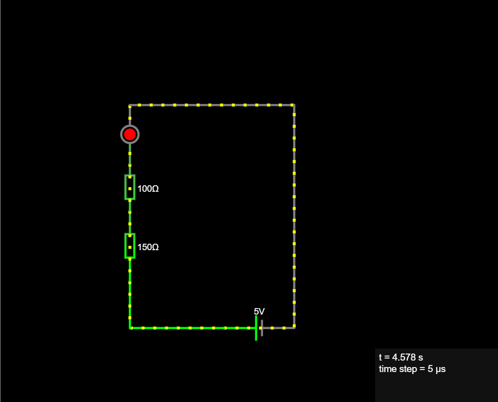
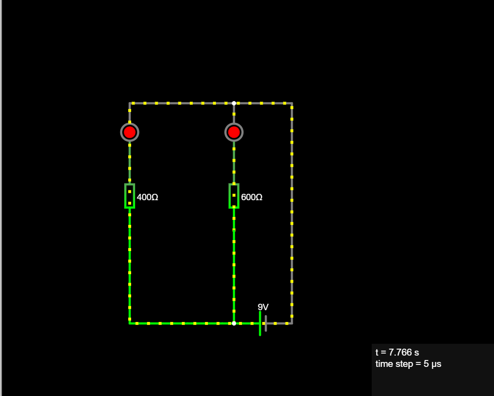
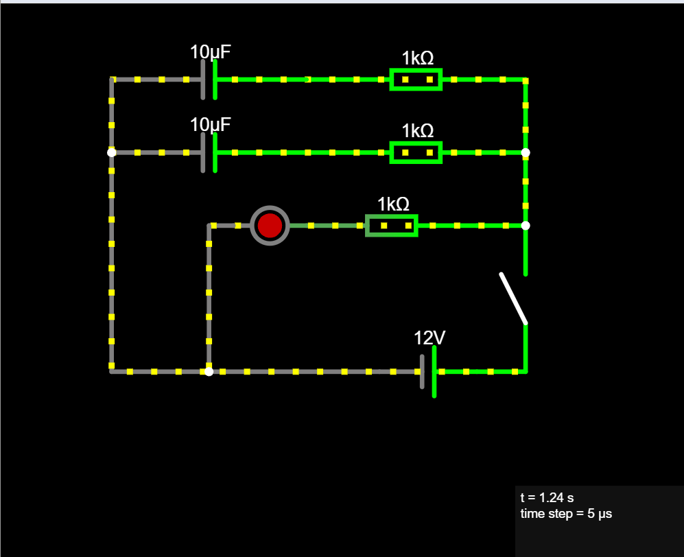
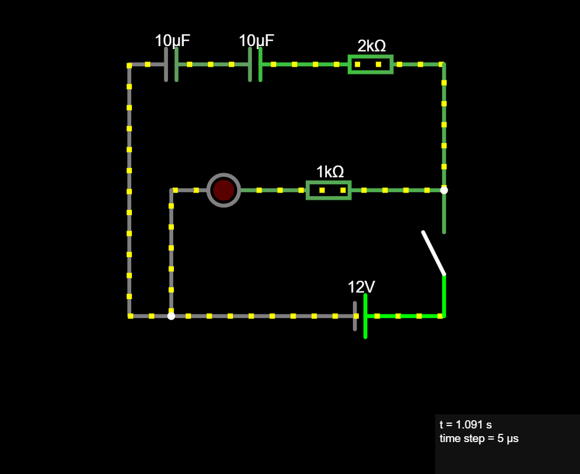

# Homework 1

All circuits are exported as txt from Falstad Circuit Simulator.

## 1. Series Circuit

Targeted current (without LED): 20mA
Voltage source: 5V

Calculated total resistance: 5V/20mA = 250 Ohms

Component values: 
 - r1: 150 ohm resistor
 - r2: 100 ohm resistor
 - red LED

Vd(LED) = 1.808 Volts

Current value: I =  (V - Vd)/ R(r1 + r2) = 5V - 1.808 / 250 = 3.192/250 = 12.7 mA
Voltage drops and power dissipated:
 - r1: V1 = 12.7 mA * 150 ohms = 1.9 Volts, P = V1 * I = 1.9 V * 12.7 mA = 24 mW
 - r2: V2 = 12.7 mA * 100 ohms = 1.27 Volts, P =  V2 * I = 1.27 V * 12.7 mA = 16 mW
 - LED: Vd = 1.808 Volts, P = 1.808 V * 12.7 mA = 22 mW

KVL TEST: 
    Vsource = V1 + V2 + Vd 
    5 = 1.9 + 1.27 + 1.808
    5 = 4,978 

## 2. Parallel Circuit

Voltage source: 9V

Component values: 
 - R1 =  400 Ohms
 - R2 =  600 Ohms

Vd(LED) = 1.808 Volts

Current values:
 - first branch: I1 = (V - Vd) / R1 = 9V - 1.808 / 400 = 7.98 mA
 - second branch: I2 = (V - Vd) / R2 = 9V - 1.808 / 600 = 5.32 mA
 - total current: I = V / R  (R - total resistance)
                     Rb1 = V/I1 = 1127 Ohms (first branch resistance)
                     Rb2 = V/I2 = 1691 Ohms (second branch resistance)
                     R = Rb1 * Rb2 / (Rb1 + Rb2) = 676.6 Ohms (Parallel group)
                     I = V / R = 9V / 676.6 = 13.3 mA

Power dissipated:
 - for R1:  P = (V - Vd) * I1 = (9V - 1.808V) * 7.98 mA = 57.39 mW
 - for R2:  P = (V - Vd) * I2 = (9V - 1.808V) * 5.32 mA = 38.26 mW

KCL TEST:
    I = I1 + I2
    13.3 mA = 7.98 mA + 5.32 mA
    13.3 mA = 13.3 mA

KVL TEST:
    V = I * R 
    9V = 13.3 mA * 676 Ohms
    9V = 8.99V

## 3. RC CIRCUIT

Voltage source: 12V

3.1. Parallel RC Circuit  

Component values:
 - C1 = 10μF - first capacitor
 - C2 = 10μF - second capacitor
 - Rc1 = 1k Ohms - resistor for the first capacitor
 - Rc2 = 1k Ohms - resistor for the second capacitor
 - Rled = 1k Ohms - resistor for LED

Equivalent capacitance:  Ctotal = C1 + C2 = 10μF + 10μF = 20 μF
Equivalent resistance: R = Rc1 || Rc2 + Rled = 1k*1k/2k + 1k = 1.5k Ohms (we ignore LED resistance)
RC time constant: RC = 20 μF * 1.5k Ohms = 30 * 10^-3 = 0.03 seconds

3.2. Series RC Circuit

Component values:
 - C1 = 10μF - first capacitor
 - C2 = 10μF - second capacitor
 - Rc = 2k Ohms 
 - Rled = 1k Ohms

Equivalent capacitance:  Ctotal = C1*C2/(C1+c2) = 10μF*10μF / 10μF + 10μF = 5μF
Equivalent resistance: R = Rc + Rled = μF
RC time constant: 5μF * 3k Ohms = 0.015 seconds

### OBS: LED fades out faster on the series RC circuit

3.3. Voltage treshold for Parallel RC circuit

V0 - initial voltage = 12V
Vt - Target voltage = 6V
RC - time constant = 0.03

Time to reach target voltage during charging:
    t = -RC * ln(1-Vt/V0) = -0.03 * ln(0.5) = -0.03 * -0.7 = 0.021 seconds
Time to reach target voltage during discharging:
    r = -RC * ln(Vt/V0) = -0.03 * ln(0.5) = 0.021 seconds
