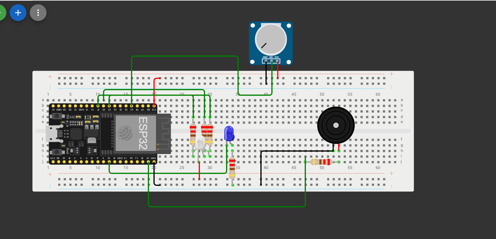

   # Homework 3 - Fan Control and Status Panel (ESP32)

## Objective

This project implements a simplified fan control and status panel for an industrial ventilation system using an ESP32 microcontroller. 

An operator adjusts the fan speed using a potentiometer. The system provides visual feedback on fan speed via an external LED (PWM control), indicates operating tiers with an RGB LED, triggers a short acoustic alert when entering high speed, and maintains an independent system heartbeat blinking on the built-in LED.

---

## Hardware Configuration

All components remain connected on a single circuit with no rewiring required between tasks.

### Pinout Table

| Component | ESP32 GPIO | Function / Notes |
| :--- | :--- | :--- |
| **Built-in LED** | `GPIO 2` | System Heartbeat (blinks continuously) |
| **External LED** | `GPIO 18` | Fan speed indicator (PWM intensity) |
| **Potentiometer** | `GPIO 34` | Speed input (ADC, connected to **3.3V**) |
| **RGB LED - Red** | `GPIO 25` | High speed status |
| **RGB LED - Green**| `GPIO 26` | Medium speed status |
| **RGB LED - Blue** | `GPIO 27` | Low speed status |
| **Passive Buzzer** | `GPIO 23` | High-speed threshold notification alert |

---

##  Requirements
  - RGB LED : 3 resistors of 220 Ohms
  - Blue RED : 1 220 Ohm resistor
  - Buzzer: 1 220 Ohm resistor
---

## Circuit Schema (Wokwi)

---

## Demonstration Video

[Click here to watch the demonstration video](https://youtu.be/6wP_Wqkczj8?is=vXMI7U89-k7fFQJ8) 

---
