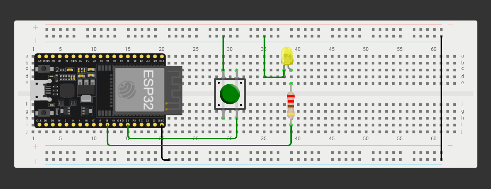

# Homework 3 - Smart Lamp Controller

An ESP32-based intelligent lamp implementation that uses non-blocking timing, hardware interrupts, and a state machine to cycle through various light modes based on short press and long press actions.

---

## Features

- **Multi-State Lighting Modes:** Off, Dim, Full, Blink, and Turbo.
- **Short Press Detection:** Cycles sequentially through standard states upon button release.
- **Long Press Detection:** Holding the button down for **$\ge$ 1.0 second** engages **Turbo Mode** (fast blink rate).
- **Automatic Turbo-to-Blink Transition:** Releasing the button while in Turbo Mode automatically switches the lamp to standard **Blink Mode**.
- **Heartbeat Indicator:** Non-blocking blinking on the board's built-in LED to indicate system operation.
- **Interrupt & Debounce System:** Mechanical button debouncing combined with hardware interrupts (`IRAM_ATTR`).

---

## Hardware & Circuit Configuration

### **Components Required**
| Component | Quantity | Description |
| :--- | :---: | :--- |
| **ESP32 Microcontroller** | 1 | Main controller board |
| **Push Button** | 1 | User interface button (Active LOW with internal pull-up) |
| **External LED** | 1 | Main lamp LED (PWM controlled) |
| **Current Limiting Resistor** | 1 | 220 $\Omega$ resistor for the main LED |
| **Breadboard & Jumpers** | - | Circuit connections |

### **Pin Mapping**
| ESP32 Pin | Component Pin | Function | Mode |
| :---: | :---: | :--- | :--- |
| **GPIO 21** | Push Button Pin | Input Trigger (Interrupt on `FALLING`) | `INPUT_PULLUP` |
| **GPIO 18** | Main LED Anode | PWM Lamp Output | `OUTPUT` |
| **GPIO 2** | Built-in LED | Heartbeat Indicator (1000 ms) | `OUTPUT` |
| **GND** | Button Pin / LED Cathode | System Ground | - |

---

## Circuit Schema

Place your schematic diagram image named `circuit_schema.png` in the same directory as this `README.md`.



*Figure 1: Circuit schematic diagram showing GPIO 21 connected to the button (grounded when pressed) and GPIO 18 driving the external LED through a limiting resistor.*

---

## Working Modes & State Machine

The system relies on an `enum LampMode` state machine to dictate brightness levels and blinking behaviors:

```
      
 ┌──────────┐     ┌──────────┐     ┌──────────┐       ┌──────────┐
 │ MODE_OFF │ ──> │ MODE_DIM │ ──> │MODE_FULL │ ───> │MODE_BLINK│
 └──────────┘     └──────────┘     └──────────┘       └──────────┘
       ▲                                                   │
       └───────────────────────────────────────────────────┘
                      [ SHORT PRESS RELEASE ]


                     [ LONG PRESS (>= 1s) ]
       ANY STATE   ─────────────────────────> ┌────────────┐
                                              │ MODE_TURBO │
                                              └────────────┘
                                                     │
                                           [ BUTTON RELEASED ]
                                                     │
                                                     ▼
                                              ┌────────────┐
                                              │MODE_BLINK  │
                                              └────────────┘
```

### **State Descriptions**

1. **`MODE_OFF`**
   - **LED State:** Completely OFF (`PWM = 0`).
2. **`MODE_DIM`**
   - **LED State:** Low Brightness (`PWM = 64` / ~25% duty cycle).
3. **`MODE_FULL`**
   - **LED State:** Maximum Brightness (`PWM = 255` / 100% duty cycle).
4. **`MODE_BLINK`**
   - **LED State:** Standard blinking mode.
   - **Interval:** Toggles between `0` and `255` every **1000 ms**.
5. **`MODE_TURBO`**
   - **Trigger:** Reached **only** when holding the button down continuously for **$\ge$ 1.0 second**.
   - **LED State:** Fast blinking mode.
   - **Interval:** Toggles between `0` and `255` every **500 ms** (`blinkInterval / 2`).
   - **Exit Behavior:** Upon releasing the button from Turbo Mode, the state automatically converts to **`MODE_BLINK`**.

### Demonstration Video :

https://youtube.com/shorts/26WtjBmJkyU