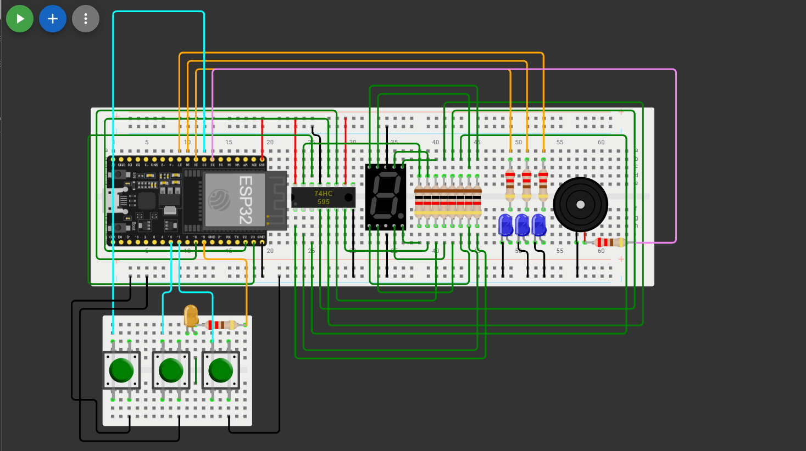

# Homework #6 - Three-Floor Elevator Controller

## Overview

This project implements a three-floor elevator controller on an ESP32 microcontroller using the ESP-IDF framework in C++. The system simulates realistic elevator behavior using a Finite State Machine (FSM), a First-In, First-Out (FIFO) request queue, software-debounced floor call buttons, visual indicators, and distinct audio notifications.

## Video Demonstration

- [Watch the Video Demonstration](https://youtu.be/NOnfVWTRhfA)

## Circuit Schematic

## Hardware Components and Pinout

| Component | ESP32 Pin / Interface | Purpose |
| :--- | :--- | :--- |
| **Push Button - Floor 1** | `GPIO 33` (Internal Pull-Up) | Registers a floor request for Floor 1 (Active LOW). |
| **Push Button - Floor 2** | `GPIO 16` (Internal Pull-Up) | Registers a floor request for Floor 2 (Active LOW). |
| **Push Button - Floor 3** | `GPIO 17` (Internal Pull-Up) | Registers a floor request for Floor 3 (Active LOW). |
| **LED - Floor 1 Request** | `GPIO 25` | Illuminates when a request for Floor 1 is active or pending in the queue; turns off upon servicing. |
| **LED - Floor 2 Request** | `GPIO 26` | Illuminates when a request for Floor 2 is active or pending in the queue; turns off upon servicing. |
| **LED - Floor 3 Request** | `GPIO 27` | Illuminates when a request for Floor 3 is active or pending in the queue; turns off upon servicing. |
| **LED - Movement Indicator** | `GPIO 19` | Blinks at 500 ms intervals while the elevator is in the `MOVING` state; remains off when stationary. |
| **Passive Buzzer** | `GPIO 32` (LEDC PWM, Channel 0, Timer 0) | Generates a short low warning tone (800 Hz) when doors begin closing and a two-tone ascending chime (1200 Hz to 1800 Hz) upon arrival. |
| **74HC595 Shift Register** | `GPIO 23` (DS - Data) `GPIO 18` (SHCP - Clock) `GPIO 22` (STCP - Latch) | Drives the 7-segment display serially (MSB first) to reduce GPIO usage. |
| **7-Segment Display** | Connected via 74HC595 outputs (Common Cathode) | Displays the elevator's current physical floor (`1`, `2`, or `3`). |

## System Architecture and Behavior

### 1. Finite State Machine (FSM)
The controller operates non-blockingly using `esp_timer_get_time()` and cycles through four states:
- **`DOORS_OPEN`**: The elevator is stationary with doors open. After a minimum dwell time of 1.5 seconds (`DOORS_OPEN_MIN_US`), it checks the FIFO queue for pending requests.
- **`DOORS_CLOSING`**: Triggered when a pending request is selected. Plays the door-closing warning tone and waits 1.5 seconds (`DOORS_CLOSING_TIME_US`) before departure.
- **`MOVING`**: Moves toward the target floor one floor at a time (2.0 seconds per floor via `TRAVEL_TIME_US`), updating the 7-segment display at each floor and blinking the movement indicator LED every 500 ms.
- **`ARRIVING`**: Reached the destination floor. Turns off the movement LED, removes the serviced floor from the queue, turns off the corresponding floor request LED, plays the arrival chime, and transitions back to `DOORS_OPEN`.

### 2. Request Queue and Input Handling
- **Software Debouncing and Edge Detection**: Each button is debounced over a 25 ms window (`DEBOUNCE_TIME_US`) and triggers only on a falling edge (HIGH to LOW transition) to prevent repeated triggers when held down.
- **FIFO Request Queue**: Implemented as a fixed-size 3-element array (`request_queue`). Duplicate requests for floors already pending in the queue—or requests for the current floor while the doors are already open—are ignored. New valid requests received while the elevator is in motion are queued and serviced in order.

## Building and Flashing

1. Ensure ESP-IDF is installed and configured in your environment.
2. Place the source code in `main/main.cpp` and verify `main/CMakeLists.txt` registers `main.cpp`.
